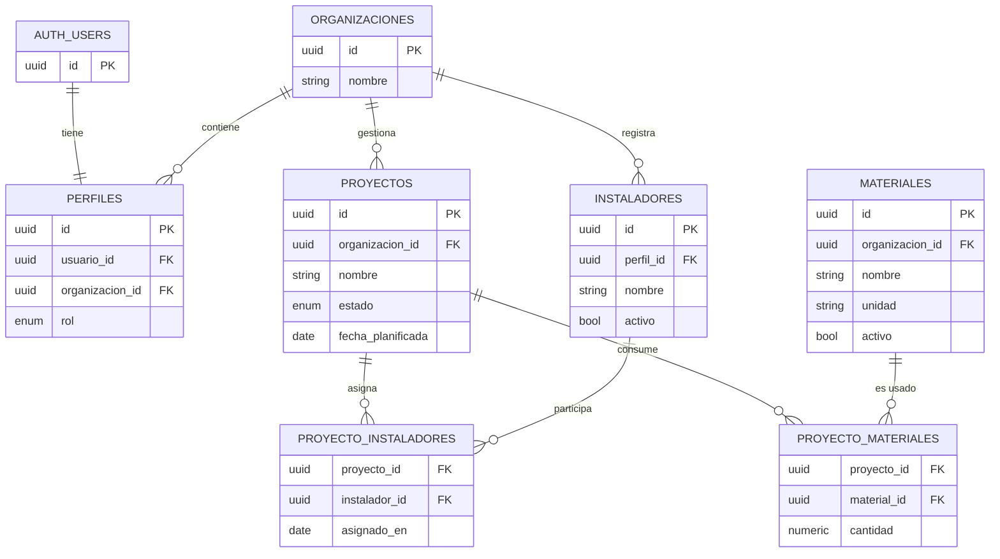

# EcoFlow — Especificación técnica

**Versión:** 0.1 · **Estado:** aprobado para fase de estructura · **Fecha:** 2026-11-18

## 1. Objetivo del producto

EcoFlow será una aplicación interna para planificar y operar proyectos de instalación de paneles solares. Centralizará proyectos, asignaciones de instaladores y consumo de materiales, con acceso diferenciado entre administradores e instaladores.

## 2. Alcance y exclusiones

### Incluido

- Autenticación con Supabase Auth.
- Roles `admin` e `installer`.
- Dashboard por estado: pendiente, en progreso y completado.
- Alta y edición de proyectos con validación.
- Asignación de uno o varios instaladores.
- Consulta de proyectos asignados al instalador autenticado.
- Catálogo de materiales y registro de cantidades usadas por proyecto.
- Estados de carga, error, vacío y éxito.
- Diseño responsive y componentes reutilizables.

### Excluido de esta fase

- Conexión real a Supabase, credenciales y variables de entorno.
- Migraciones o ejecución de SQL.
- Dashboard funcional, CRUD y flujos de autenticación.
- Facturación, compras, inventario global, notificaciones, mapas y aplicación móvil.
- Reutilización de código, credenciales o repositorios de TaskMaster AI.

## 3. Roles y permisos

| Capacidad | Administrador | Instalador |
|---|---:|---:|
| Ver dashboard de la organización | Sí | Solo resumen de asignados |
| Crear/editar/cancelar proyectos | Sí | No |
| Asignar instaladores | Sí | No |
| Ver proyecto | Todos de su organización | Solo proyectos asignados |
| Gestionar catálogo de materiales | Sí | No |
| Registrar materiales utilizados | Sí | Sí, en proyectos asignados |
| Gestionar usuarios/roles | Flujo administrativo seguro | No |

El rol efectivo se obtiene de `public.perfiles.rol`, vinculado por FK a `auth.users.id`. Nunca se acepta el rol desde el cliente como autoridad. La primera cuenta administradora se provisiona mediante un procedimiento operativo controlado (SQL ejecutado por un operador autorizado o backend con `service_role` fuera del navegador); el alta normal crea siempre `installer` o queda pendiente de aprobación.

## 4. Historias de usuario

- **HU-01:** Como usuario, quiero iniciar sesión para acceder solo a las funciones permitidas.
- **HU-02:** Como administrador, quiero visualizar proyectos agrupados por estado para priorizar la operación.
- **HU-03:** Como administrador, quiero crear un proyecto con cliente, dirección, potencia objetivo y fecha planificada.
- **HU-04:** Como administrador, quiero asignar varios instaladores a un proyecto.
- **HU-05:** Como instalador, quiero consultar mis proyectos asignados y su estado.
- **HU-06:** Como instalador, quiero registrar los materiales utilizados en una visita.
- **HU-07:** Como administrador, quiero mantener un catálogo de materiales activo con unidad y stock de referencia.
- **HU-08:** Como usuario, quiero mensajes claros de carga, error y ausencia de resultados.

## 5. Reglas de negocio

1. Un proyecto pertenece a una sola organización y tiene exactamente un estado.
2. El flujo normal es `pending → in_progress → completed`; `cancelled` es terminal y solo administrativo.
3. Un proyecto no puede marcarse como completado sin al menos un instalador asignado.
4. Un instalador no puede ver proyectos solo por conocer su UUID: debe existir una fila vigente en `proyecto_instaladores`.
5. Las cantidades de materiales son positivas y usan la unidad definida por el catálogo.
6. Un material inactivo no puede añadirse a nuevos consumos.
7. Las asignaciones son únicas por proyecto e instalador.
8. Fechas y potencia deben ser válidas; la fecha planificada no puede ser anterior a la fecha de creación lógica.
9. Toda mutación debe comprobar la organización del usuario y el rol en base de datos, no únicamente en la UI.

## 6. Requisitos funcionales

- **RF-01:** iniciar/cerrar sesión y recuperar sesión vigente.
- **RF-02:** cargar perfil y rol antes de renderizar rutas protegidas.
- **RF-03:** listar proyectos con filtros por estado, búsqueda y paginación.
- **RF-04:** crear y editar proyectos con validación de esquema.
- **RF-05:** gestionar asignaciones many-to-many.
- **RF-06:** consultar proyectos asignados al instalador autenticado.
- **RF-07:** listar materiales y registrar consumos por proyecto.
- **RF-08:** renderizar estados `loading`, `error`, `empty` y `success` en cada consulta/mutación.

## 7. Requisitos no funcionales

- TypeScript estricto, sin `any` salvo adaptadores justificados.
- RLS activa en cada tabla expuesta en `public`.
- Componentes accesibles, navegación por teclado y etiquetas de formulario.
- Responsive desde 320 px hasta escritorio.
- Consultas paginadas, índices sobre FKs y columnas de filtro.
- Servicios aislados de componentes; no realizar llamadas Supabase directamente desde presentaciones.
- Errores sin filtrar secretos ni detalles internos al usuario.

## 8. Criterios de aceptación verificables

- CA-01: una sesión sin perfil válido no obtiene rutas protegidas.
- CA-02: un instalador autenticado recibe cero proyectos no asignados al consultar la vista de proyectos.
- CA-03: una cuenta estándar no puede insertar o actualizar `perfiles.rol = 'admin'` desde el cliente.
- CA-04: un proyecto inválido bloquea el envío y muestra errores por campo.
- CA-05: el alta de proyecto exige organización y datos obligatorios válidos.
- CA-06: el dashboard diferencia correctamente los tres estados operativos.
- CA-07: una asignación duplicada es rechazada por restricción de unicidad.
- CA-08: una cantidad cero o negativa de material es rechazada por validación y CHECK.
- CA-09: cada consulta muestra loading, error y empty cuando corresponde.
- CA-10: `npm run build` y `npm run lint` pasan en el scaffold de cada fase, sin afirmar pruebas no ejecutadas.

## 9. Arquitectura de componentes, hooks y servicios

La aplicación se dividirá por dominio: `features/auth`, `features/dashboard`, `features/projects` y `features/materials`. `components` contiene piezas visuales reutilizables; `services` encapsula Supabase; `hooks` coordina estado remoto y sesión; `validators` define esquemas; `types` contiene contratos generados o escritos con tipado explícito.

Componentes previstos: `AppShell`, `ProtectedRoute`, `RoleGate`, `ProjectStatusBoard`, `ProjectForm`, `ProjectCard`, `InstallerMultiSelect`, `MaterialUsageForm`, `AsyncState` y `EmptyState`.

Hooks previstos: `useAuth`, `useCurrentProfile`, `useProjects`, `useProject`, `useProjectAssignments` y `useProjectMaterials`. Servicios previstos: `authService`, `projectService`, `installerService` y `materialService`.

## 10. Modelo relacional y relaciones

`perfiles` resuelve identidad/rol/organización; `instaladores` aporta datos operativos del instalador. Las tablas puente modelan las relaciones N:M entre proyectos e instaladores y entre proyectos y materiales. `organizaciones` se incluye para que el aislamiento multiempresa sea explícito desde el inicio, aunque la primera entrega pueda operar con una organización.

## 11. Estrategia RLS

Las políticas se describen con detalle en `04_SEGURIDAD_RLS.md`. En resumen, se usa `auth.uid()` para identificar al usuario y funciones SQL `security definer` pequeñas y revisadas para resolver rol/organización sin depender de datos enviados por el cliente. No se concede `service_role` al frontend.

## 12. Estrategia de validación

Validación de formulario en cliente para feedback inmediato y validación en base de datos para invariantes. Se recomienda Zod en `validators/`, con tipos inferidos, normalización de strings, límites de longitud, enumeraciones cerradas, fechas ISO y cantidades decimales acotadas. Los errores de Supabase se transforman a mensajes de dominio sin ocultar el error a observabilidad.

## 13. Estrategia de pruebas

La siguiente fase debe incluir pruebas unitarias de validadores y funciones de permisos; pruebas de componentes para estados; pruebas de integración con Supabase local o mocks controlados; y pruebas E2E de login, aislamiento por rol, alta de proyecto, asignación y materiales. También se deben probar políticas RLS con usuarios de ambos roles. No se declaran resultados hasta ejecutar esas pruebas.

## Prompt maestro de arquitectura

Actúa como arquitecto senior de EcoFlow, una aplicación interna React + TypeScript + Vite + Tailwind CSS + Supabase Auth/PostgreSQL/RLS para gestionar instalaciones solares. Respeta estas restricciones: no reutilices código de TaskMaster AI; no expongas credenciales ni `service_role`; no otorgues autoridad al cliente para decidir roles u organización; mantén administradores e instaladores separados mediante `public.perfiles` y políticas RLS; los instaladores solo pueden consultar y operar proyectos con asignación vigente; los administradores solo operan dentro de su organización.

Usa arquitectura modular por dominios, componentes presentacionales reutilizables, hooks para coordinación de estado y servicios para acceso a datos. Mantén TypeScript estricto, contratos explícitos, tipos derivados de esquemas cuando sea posible, y evita `any`. Valida entradas tanto en UI como en base de datos; usa enumeraciones cerradas, CHECK, FK, unicidad, índices y transacciones/RPC cuando una operación sea compuesta. Cada pantalla debe contemplar loading, error, empty y success, además de accesibilidad y responsive.

Antes de implementar, explica supuestos, impacto en el modelo de datos, permisos RLS, riesgos y criterios de aceptación. No inventes pruebas ni resultados: distingue entre diseñado, implementado y verificado. Documenta cada decisión, problema, corrección y validación en la bitácora de IA. Si faltan datos, elige la alternativa más segura y deja la decisión pendiente explícita.

