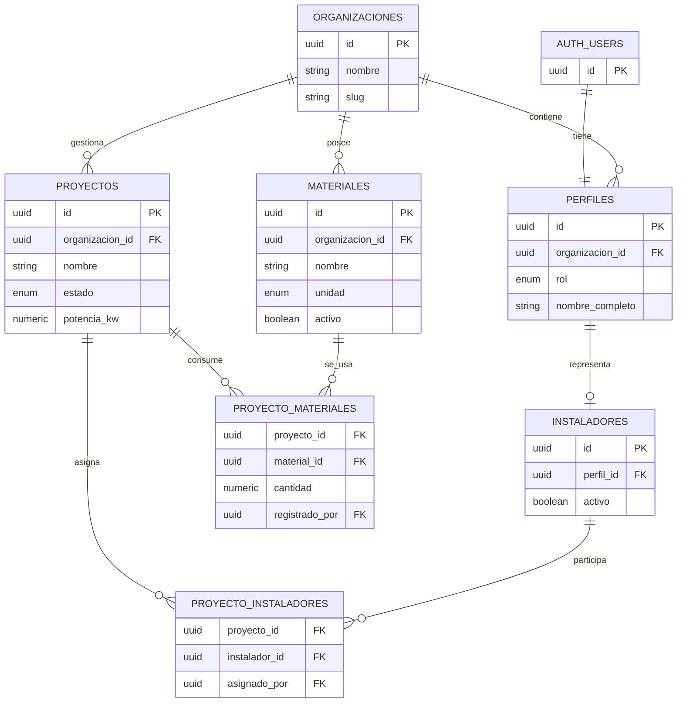

# EcoFlow — Entrega académica de arquitectura

**Estado:** preparado para revisión académica  
**Stack:** React 19, TypeScript, Vite, Tailwind CSS 4, Supabase Auth/PostgreSQL/RLS, TanStack Query y React Router  
**Alcance:** aplicación interna para gestionar proyectos de instalación solar

## 1. Descripción del sistema

EcoFlow centraliza proyectos de instalación de paneles solares, instaladores, materiales y consumos. La aplicación autentica usuarios con Supabase Auth, obtiene el rol desde `public.perfiles` y consulta PostgreSQL mediante el cliente público de Supabase. Las políticas Row Level Security son la autoridad definitiva: el frontend oculta controles por experiencia de usuario, pero no sustituye la autorización de base de datos.

La aplicación incluye login, dashboard, listado y detalle de proyectos, alta administrativa, filtros por estado, asignación de instaladores, catálogo de materiales, consumos por proyecto y actualización de estados.

## 2. Arquitectura React + Supabase

```text
Browser
  └── React Router
      ├── AuthProvider + ProtectedRoute
      ├── AppShell
      │   ├── DashboardPage
      │   ├── ProjectsPage / ProjectDetailPage
      │   ├── MaterialsPage
      │   └── DiagnosticPage
      └── Hooks TanStack Query
          └── Services de dominio
              └── Supabase JS con clave pública
                  └── Auth + PostgreSQL + RLS
```

### Capas

- `features/`: páginas por dominio y proveedor de autenticación.
- `components/`: layout, tarjetas, formularios, paneles y estados reutilizables.
- `hooks/`: sesión, perfil, consultas y mutaciones con caché.
- `services/`: única frontera para Auth y datos Supabase.
- `types/`: tipos manuales derivados del esquema SQL, pendientes de reemplazo por generación oficial.
- `validators/` y `lib/`: validaciones, permisos de presentación y etiquetas.
- `supabase/`: migración versionada y pruebas SQL.

## 3. Modelo de datos



### Tablas y relaciones

| Tabla | Responsabilidad | Relación principal |
|---|---|---|
| `organizaciones` | Tenant y aislamiento de datos | Una organización contiene perfiles, proyectos y materiales |
| `perfiles` | Identidad interna, rol y organización | FK 1:1 con `auth.users` |
| `instaladores` | Datos operativos del instalador | FK 1:1 con un perfil de rol `installer` |
| `proyectos` | Unidad de trabajo solar | Pertenece a una organización y a un creador Auth |
| `proyecto_instaladores` | Asignación N:M | PK compuesta proyecto/instalador |
| `materiales` | Catálogo por organización | Unidad cerrada y estado activo |
| `proyecto_materiales` | Consumo por proyecto | PK compuesta proyecto/material y cantidad positiva |

Las relaciones N:M se resuelven con tablas puente. Los triggers SQL validan además que proyecto, instalador, material y actores de auditoría pertenezcan a la misma organización.

## 4. Roles y RLS

| Recurso | Administrador de organización | Instalador asignado | Instalador no asignado |
|---|---:|---:|---:|
| Consultar proyectos | Sí, de su organización | Sí, solo asignados | No |
| Crear/editar proyectos | Sí | No | No |
| Cambiar estado | Sí | No | No |
| Gestionar asignaciones | Sí | No | No |
| Consultar materiales | Sí | Activos de su organización | Activos de su organización |
| Crear materiales | Sí | No | No |
| Registrar consumos | Sí | En proyectos asignados | No |
| Cambiar rol u organización | Flujo controlado | No | No |

RLS está activa en las siete tablas de negocio. Las funciones `SECURITY DEFINER` (`current_organization_id`, `is_ecoflow_admin`, `can_access_project`) tienen `search_path` fijo y permisos `EXECUTE` limitados. El cliente nunca recibe `service_role` y no decide el rol ni la organización.

## 5. Componentes, hooks y servicios

Componentes principales: `AppShell`, `ProtectedRoute`, `AsyncState`, `ProjectCard`, `ProjectForm`, `InstallerAssignmentPanel`, `MaterialCatalogPanel` y `ProjectMaterialsPanel`.

Hooks principales: `useAuth`, `useCurrentProfile`, `useProjects`, `useProjectStatus`, `useInstallers` y `useMaterials`.

Servicios principales: `authService`, `profileService`, `projectService`, `installerService` y `materialService`.

TanStack Query gestiona caché, estados de carga/error y la invalidación de listas después de mutaciones.

## 6. TypeScript y validación

TypeScript estricto se usa en componentes, servicios y tipos de dominio. `src/types/database.ts` es manual y derivado de la migración; todavía no debe presentarse como generado por una instancia Supabase. El formulario de proyectos valida nombre, cliente, dirección y potencia positiva. Los consumos validan cantidades mayores que cero. Las restricciones SQL repiten las invariantes en la base de datos.

## 7. Prompts y uso de IA

La bitácora completa está en [docs/05_PROMPT_LOG.md](05_PROMPT_LOG.md). Los prompts más relevantes fueron:

- **Prompt 01:** creó el scaffold y la especificación base.
- **Prompt 02:** definió migración PostgreSQL, tablas, triggers, funciones y RLS.
- **Prompt 03:** preparó Supabase JS, entorno y guía de configuración.
- **Prompt 04:** preparó ejecución manual y consultas de verificación.
- **Prompt 05:** creó la pantalla temporal de login y diagnóstico RLS.
- **Prompt 06:** transformó el diagnóstico en dashboard React modular.
- **Prompt 07:** completó instaladores, materiales, consumos, estados, pruebas y optimización.

### Ejemplo técnico: UUID de instalador y RLS

La asignación utiliza `proyecto_instaladores.instalador_id`, que referencia `instaladores.id`; no utiliza directamente el UUID de `auth.users`. El usuario Auth se relaciona con `perfiles.id`, y el perfil se relaciona con `instaladores.perfil_id`. Esta separación evita enviar al formulario un identificador de organización o confundir identidad Auth con identidad operativa. La interfaz carga los instaladores activos y usa el UUID real de `instaladores.id`; la PK compuesta evita duplicados y RLS/triggers validan pertenencia organizacional.

La validación RLS de cuatro escenarios fue reportada manualmente por el usuario: administrador ve el proyecto, Instalador QA 1 ve su asignación, Instalador QA 2 recibe cero proyectos y una sesión ausente no consulta. Codex no ejecutó automáticamente esas pruebas.

## 8. Pruebas y resultados

### Ejecutadas por Codex

- `npm run lint`: correcto.
- `npm test`: correcto; 3 archivos y 6 pruebas Vitest exitosas.
- `npm run build`: correcto.

Las pruebas automatizadas cubren validadores, etiquetas de estados, unidades de materiales y permisos de presentación.

### Reportadas por el usuario

Los cuatro escenarios RLS manuales y el funcionamiento del dashboard/creación de proyectos fueron reportados como exitosos por el usuario. No se atribuyen como ejecución automática de Codex.

### Pendientes de evidencia propia

No se ejecutaron desde esta sesión pruebas de navegador, asignaciones remotas, consumos remotos ni cambios de estado contra Supabase.

## 9. Seguridad

- `.env.local`, `.env` y archivos privados de entorno están excluidos por `.gitignore`.
- `.env.example` contiene solo placeholders.
- No hay claves reales en el código fuente.
- `service_role` no se referencia como credencial de frontend.
- La UI no sustituye RLS.
- No se modificaron políticas ni migraciones durante las fases funcionales.

## 10. Limitaciones

- La pantalla de diagnóstico sigue disponible como ruta temporal.
- Los tipos Supabase aún son manuales.
- Las pruebas automatizadas no sustituyen pruebas E2E ni pruebas RLS con base remota.
- La validación de mutaciones remotas queda pendiente de ejecución manual.
- El primer administrador continúa siendo un flujo controlado fuera del frontend.

